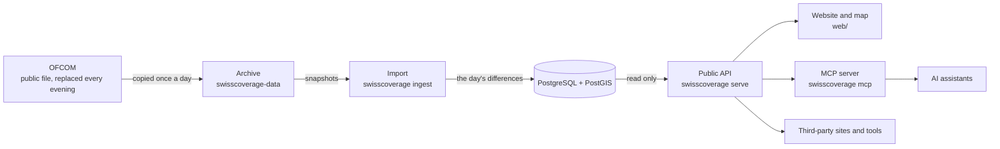
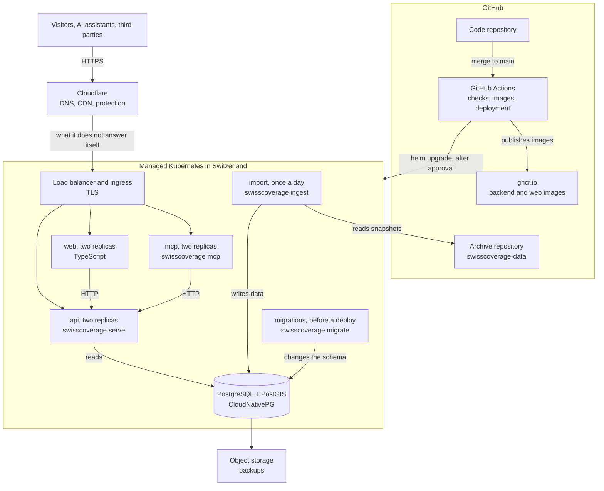

# Architecture

This page says how swisscoverage is put together and where a change belongs.
The project is at its beginning: each part below is marked **exists** or
**planned**. Update this page in the pull request that makes a planned part
real, or that changes the plan.

Two pages go with it:

- [decisions.md](decisions.md): why each choice was made, what was rejected,
  and what would make us change our mind. This page states the result and
  links there for the reasons.
- [roadmap.md](roadmap.md): the order of work.

## Principles

1. **The archive is the source of truth.** Every daily file from OFCOM is
   kept, in a separate repository,
   [swisscoverage-data](https://github.com/mathieumaf/swisscoverage-data): the
   original, and a line-per-site form that git can compare from one day to the
   next. The database is derived from the archive and can be rebuilt from it at
   any time, so a parsing bug never destroys information.
2. **One API, several clients.** The website, the MCP server and third parties
   all read the same public HTTP API. Neither the website nor the MCP server
   has any other way to the data. A feature that the map needs is a feature of
   the API.
3. **Data only from sources we may use.** Official open data, documents
   obtained under the Freedom of Information Act, and contributions whose
   origin is known. Never data scraped from another website or app. See
   [data-sources.md](data-sources.md).
4. **Reproducible by anyone.** A contributor can run the whole stack locally
   with one command, and anyone can host their own instance. Nothing in the
   repository depends on a service only the maintainer can use.

## How data flows



Data moves in one direction, from OFCOM to the people who read it. The API
only reads: no visitor can change the data. If the database is lost, the import
loads it again from the archive.

The import reads the original files, which the archive attaches, gzipped, to
one release per year. It finds them and checks them through an index of
snapshots that the archive will publish: one line per snapshot with its
publication time, its checksum and its number of sites. The index does not
exist yet; it is added with the import.

A typical day:

| When (UTC)   | What happens                                                           | State   |
| ------------ | ---------------------------------------------------------------------- | ------- |
| around 22:00 | OFCOM replaces its file.                                               |         |
| 04:17        | The archive copies it, verifies its checksum and commits it.           | exists  |
| 05:00        | The import compares it with the day before and writes the differences. | planned |
| afterwards   | The API, the map and the MCP server serve the day's data.              | planned |

## Parts

| Part       | Where                                                                  | State   | Role                                                                                                                           |
| ---------- | ---------------------------------------------------------------------- | ------- | ------------------------------------------------------------------------------------------------------------------------------ |
| Archive    | [swisscoverage-data](https://github.com/mathieumaf/swisscoverage-data) | exists  | A separate repository. A scheduled workflow downloads OFCOM's file once a day, checks it against the catalogue and commits it. |
| Backend    | `backend/` (Go)                                                        | started | One program, `swisscoverage`. See its commands below.                                                                          |
| Parser     | `backend/internal/ofcom`                                               | exists  | Turns OFCOM's file into a typed model. Pure: no network, no file system, no database, no clock.                                |
| Store      | `backend/internal/store`                                               | planned | SQL queries and migrations for PostgreSQL with PostGIS. Converts positions from LV95 to WGS84.                                 |
| API        | `backend/internal/api`, `openapi.json`                                 | planned | The public, read-only HTTP API and its contract.                                                                               |
| MCP server | `backend/internal/mcp`                                                 | planned | Tools for AI assistants. A client of the public API over HTTP, with no access to the database.                                 |
| Website    | `web/` (TypeScript)                                                    | planned | The map and the pages. A client of the public API over HTTP.                                                                   |
| Deployment | `deploy/`                                                              | planned | Docker Compose for local work and tests; a Helm chart for Kubernetes in production.                                            |

The `swisscoverage` program has four commands that run in production and two
that are tools for developers. Only `parse` exists today.

| Command   | What it does                                                                 | Runs as               |
| --------- | ---------------------------------------------------------------------------- | --------------------- |
| `serve`   | Serves the public API.                                                       | a service             |
| `mcp`     | Serves the MCP tools, by calling the public API.                             | a service             |
| `ingest`  | Loads snapshots from the archive into the database.                          | a daily job           |
| `migrate` | Applies the schema migrations.                                               | a job before a deploy |
| `parse`   | Reads a source file and prints what the parser makes of it. Touches nothing. | by hand               |
| `openapi` | Prints the API contract, to write or to check `openapi.json`.                | by hand and in CI     |

## Repository layout

Planned, except what is marked as existing.

```
swisscoverage/
├── backend/                   Go; exists
│   ├── cmd/swisscoverage/     the program and its commands; exists
│   └── internal/
│       ├── ofcom/             parser for the source file; pure; exists
│       ├── store/             SQL queries and migrations
│       ├── api/               REST routes and the contract they generate
│       └── mcp/               MCP tools; calls the API over HTTP
├── web/                       TypeScript: website and map
├── openapi.json               the API contract, generated and committed
├── deploy/
│   ├── compose.yaml           local work and tests
│   └── helm/                  production
└── docs/                      exists
```

Rules that keep it honest:

- **The parser stays pure.** No network, no file system, no database, no
  environment, no clock. It receives the bytes of a file from the command
  that calls it. Its tests read the samples in `testdata/` and nothing else.
- **`web/` and `internal/mcp` never use server code and never open a database
  connection.** They know the API through its contract only. Two things
  enforce it for the MCP server, which lives in the same program as the API: a
  test fails the build when `internal/mcp` imports `internal/api`,
  `internal/store` or a database driver, and the deployment gives database
  credentials only to the API, the import and the migrations.
- **The archive stays in its own repository**, so cloning the code does not
  download years of data.

## The API contract

`swisscoverage openapi` prints the contract from the code, and the result is
committed as `openapi.json`. CI runs the command and fails when its output
differs from the committed file. The website's types and the MCP server's
client are generated from that file.

The contract is public API: changing it is a High-risk change (see
`AGENTS.md`). The reasons are in [decision 8](decisions.md).

## Data model

Three tables are enough for version 0.1, history included.

| Table           | One row is                                 | Main columns                                                                             |
| --------------- | ------------------------------------------ | ---------------------------------------------------------------------------------------- |
| `snapshot`      | A file published by OFCOM on a given day.  | `published_at`, `sha256`, `sites`                                                        |
| `station`       | A site: what does not change.              | `name`, `operator`, `code`, position in LV95 and WGS84, `first_seen`, `last_seen`        |
| `station_state` | What was known of a site between two days. | `valid_from`, `valid_to`, kind, power class, technologies, adaptive, permit, limit value |

- **A site is identified by its label and its position together**, because
  OFCOM publishes no stable identifier ([decision 11](decisions.md)).
- **A row of `station_state` covers the whole period during which nothing
  changes.** A site that is stable for a year is one row, not 365. "What
  changed, and when" is then a query on `valid_from` and `valid_to`.
- **A snapshot's row comes from the archive's index**: its publication time,
  its checksum and its number of sites.

## Stack

Choices marked "candidate" are confirmed in the roadmap step that introduces
them. Choices marked "open" are questions listed in
[decisions.md](decisions.md).

| Role                 | Choice                                                        | Notes                                                                                |
| -------------------- | ------------------------------------------------------------- | ------------------------------------------------------------------------------------ |
| API, import, MCP     | Go                                                            | One static binary. The MCP server may move to another language if Go fits it badly.  |
| API description      | OpenAPI 3.1, generated from the Go code                       | Huma is the candidate library.                                                       |
| MCP server           | The official MCP SDK for Go                                   | Read-only tools, served to assistants over Streamable HTTP.                          |
| Database             | PostgreSQL with PostGIS                                       | Spatial queries, history, and the rigorous LV95 to WGS84 transformation.             |
| Database access      | SQL written by hand, typed code generated                     | `pgx` and `sqlc` are the candidates.                                                 |
| Migrations           | Versioned SQL files                                           | Applied by `migrate`. They stay compatible with the previous version of the program. |
| Website              | TypeScript; Astro with React for the map                      | Server-rendered pages are the recommended baseline; still open.                      |
| Map                  | MapLibre GL                                                   | The base map is open.                                                                |
| Checks               | `gofmt`, `go vet`, `go test`; Biome; `tsc` once `web/` exists | One CI job per part, gathered by the job named `check`, the only required one.       |
| Local work and tests | Docker Compose                                                |                                                                                      |
| Production           | Kubernetes, Helm, CloudNativePG                               | Meant for a managed cluster in Switzerland; must work on a self-managed one.         |
| In front of the site | Cloudflare                                                    | DNS and CDN. What it caches is open.                                                 |
| Releases             | GitHub Actions, GitHub container registry                     | Deployment waits for the maintainer's approval.                                      |

The backend uses Go's standard library only, including for its command line,
until a step needs more. The Go version is the `go` line of `backend/go.mod`,
which CI installs. Until `web/` exists, the only JavaScript tool is Biome, run
with Bun to check Markdown, JSON and YAML.

## Deployment

Planned, and not built yet. The hostnames, the number of nodes and the way
Cloudflare connects to the cluster are settled when the site goes online; what
is shown here is the recommendation.



An arrow goes from the one that calls to the one that answers.

- **Two images.** `backend` holds the `swisscoverage` program and runs as the
  API, the MCP server, the import and the migrations, each with its own
  command. `web` holds the website.
- **Replicas.** The website, the API and the MCP server each run twice, so an
  update replaces one while the other answers.
- **Who touches the database.** The import writes data and the migrations
  change the schema, each with its own role. The API connects with a role that
  can only read. The MCP server and the website have no database credentials
  at all.
- **A release.** A merge to `main` builds and publishes both images from the
  same commit. Deployment runs through a protected GitHub environment and
  waits for approval.
- **Two versions overlap during an update, and after a rollback.** The schema
  and the API therefore stay compatible with the previous version for as long
  as it may still run or be restored: a migration adds, with a default, and
  does not remove or tighten what the previous version relies on, and a change
  to the API adds without changing what exists. The order matters too: the API
  is updated before the website and the MCP server, and rolled back after
  them, so a client never calls an API older than the one it was built for.
- **Secrets.** The database passwords are created inside the cluster and stay
  there. GitHub holds only an access limited to the application's namespace.
- **Backups.** Daily, to object storage. Today they only save time, since
  everything can be rebuilt from the archive. They become essential the day the
  database holds data that cannot be rebuilt, such as speed tests.
- **Cloudflare.** It serves DNS and sits in front of every public hostname:
  the website, the API and the MCP server. Nothing may depend on it
  ([decision 16](decisions.md)).
- **If the site ends up as a map only**, which is still open, the `web` image
  serves static files instead of rendering pages. Nothing else changes.
- **Local and tests.** Docker Compose starts the database and the application.

Recommended hostnames, to confirm when the site goes online:
`swisscoverage.ch` for the website, `api.swisscoverage.ch` for the API and
`mcp.swisscoverage.ch` for the MCP server.

## Where a change belongs

- **Understanding a source file** (a new label, a new field, a new dataset):
  the parser, `backend/internal/ofcom`, with a test that uses a real sample of
  the file.
- **Anything that needs the database**: `backend/internal/store`.
- **A new question the data should answer**: the API first, with its contract,
  then the website or the MCP server on top of it.
- **How it runs in production**: `deploy/`, and this page.

How the parser treats what it does not expect:

- **A label it does not recognise** never stops the run. The station is kept,
  what the parser does recognise is kept, the rest is set to unknown, null or
  an empty list, and a warning says what was found.
- **A file that is not the dataset** stops the run: not a FeatureCollection,
  or coordinates in another reference system.
- **A feature without a field every station has** (its label, its position, or
  one of the expected properties) also stops the run. That is a change of
  format, not a new label, and it needs a person to look.
