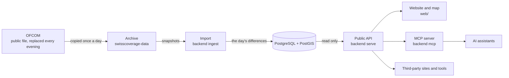
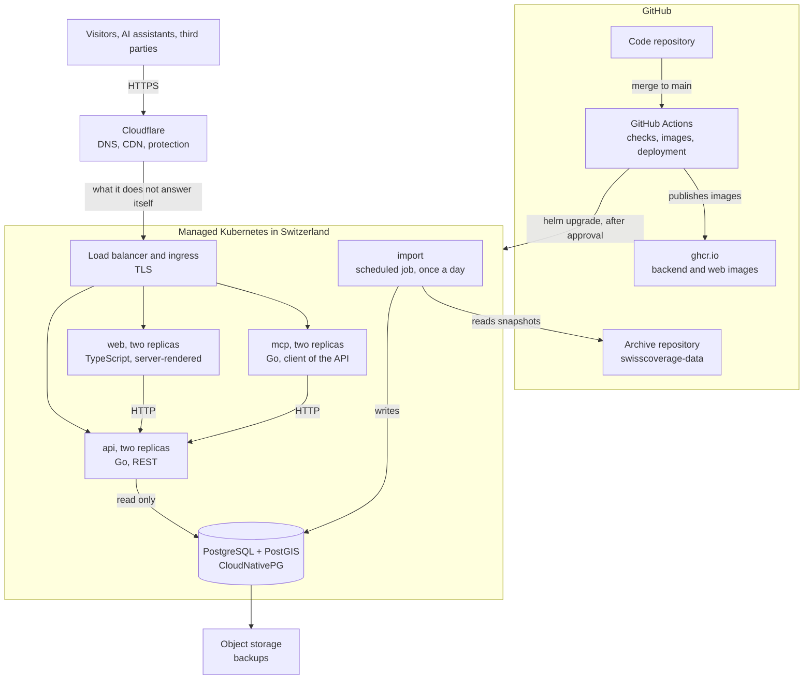

# Architecture

This page says how swisscoverage is put together and where a change belongs.
The project is at its beginning: each part below is marked **exists** or
**planned**. Update this page in the pull request that makes a planned part
real, or that changes the plan.

Two pages go with it:

- [decisions.md](decisions.md): why each choice was made, what was rejected,
  and what would make us change our mind.
- [roadmap.md](roadmap.md): the order of work.

## Principles

1. **The archive is the source of truth.** Every daily file from OFCOM is
   kept, in a separate repository,
   [swisscoverage-data](https://github.com/mathieumaf/swisscoverage-data): the
   original, and a line-per-site form that git can compare from one day to the
   next. The database is derived from the archive and can be rebuilt from it at
   any time, so a parsing bug never destroys information.
2. **One API, several clients.** The website, the MCP server and third parties
   all read the same public HTTP API. Neither the website nor the MCP server
   has any other way to the data. A feature that the map needs is a feature of
   the API.
3. **Data only from sources we may use.** Official open data, documents
   obtained under the Freedom of Information Act, and contributions whose
   origin is known. Never data scraped from another website or app. See
   [data-sources.md](data-sources.md).
4. **Reproducible by anyone.** A contributor can run the whole stack locally
   with one command, and anyone can host their own instance. Nothing in the
   repository depends on a service only the maintainer can use.

## How data flows



Data moves in one direction, from OFCOM to the people who read it. The API
only reads: no visitor can change the data. If the database is lost, the import
loads it again from the archive.

A typical day:

| When (UTC)   | What happens                                                           | State   |
| ------------ | ---------------------------------------------------------------------- | ------- |
| around 22:00 | OFCOM replaces its file.                                               |         |
| 04:17        | The archive copies it, verifies its checksum and commits it.           | exists  |
| 05:00        | The import compares it with the day before and writes the differences. | planned |
| afterwards   | The API, the map and the MCP server serve the day's data.              | planned |

## Parts

| Part       | Where                                                                  | State   | Role                                                                                                                            |
| ---------- | ---------------------------------------------------------------------- | ------- | ------------------------------------------------------------------------------------------------------------------------------- |
| Archive    | [swisscoverage-data](https://github.com/mathieumaf/swisscoverage-data) | exists  | A separate repository. A scheduled workflow downloads OFCOM's file once a day, checks it against the catalogue and commits it.  |
| Parser     | `packages/core` (TypeScript)                                           | exists  | Turns OFCOM's file into a typed model. It is the reference for the Go port and is removed once the port passes the same tests.  |
| Backend    | `backend/` (Go)                                                        | planned | One program with four commands: `serve` (the API), `mcp` (the MCP server), `ingest` (the daily import), `migrate` (the schema). |
| Parser     | `backend/internal/ofcom`                                               | planned | The Go port of the parser. Pure: no network, no database, no clock.                                                             |
| Store      | `backend/internal/store`                                               | planned | SQL queries and migrations for PostgreSQL with PostGIS. Converts positions from LV95 to WGS84.                                  |
| API        | `backend/internal/api`, `openapi.json`                                 | planned | The public, read-only HTTP API and its contract.                                                                                |
| MCP server | `backend/internal/mcp`                                                 | planned | Tools for AI assistants. A client of the public API over HTTP, with no access to the database.                                  |
| Website    | `web/` (TypeScript)                                                    | planned | The map and the pages. A client of the public API over HTTP.                                                                    |
| Deployment | `deploy/`                                                              | planned | Docker Compose for local work and tests; a Helm chart for Kubernetes in production.                                             |

## Repository layout

Planned. Only `packages/core` and `docs/` exist today.

```
swisscoverage/
├── backend/                   Go
│   ├── cmd/swisscoverage/     one program: serve, mcp, ingest, migrate
│   └── internal/
│       ├── ofcom/             parser for the source file; pure
│       ├── store/             SQL queries and migrations
│       ├── api/               REST routes; generates openapi.json
│       └── mcp/               MCP tools; calls the API over HTTP
├── web/                       TypeScript: website and map
├── openapi.json               the API contract, generated and committed
├── deploy/
│   ├── compose.yaml           local work and tests
│   └── helm/                  production
└── docs/
```

Rules that keep it honest:

- **The parser stays pure.** No network, no file system, no database, no
  environment, no clock. Its tests read fixtures and nothing else.
- **`web/` and `internal/mcp` never import server code and never open a
  database connection.** They know the API through its contract only.
- **The archive stays in its own repository**, so cloning the code does not
  download years of data.

## The API contract

The backend generates `openapi.json` from its code, and the file is committed.

- A change to the API therefore shows up in the pull request's diff, where it
  can be reviewed like any other change.
- CI regenerates the file and fails when it differs from the committed one.
- The website's types are generated from it, so an API change that breaks the
  website fails the website's build, not production.

The contract is public API: changing it is a High-risk change (see `AGENTS.md`).

## Data model

Three tables are enough for version 0.1, history included.

| Table           | One row is                                | Main columns                                                                             |
| --------------- | ----------------------------------------- | ---------------------------------------------------------------------------------------- |
| `snapshot`      | A file published by OFCOM on a given day. | `published_at`, `sha256`, `sites`                                                        |
| `station`       | A site: what does not change.             | `name`, `operator`, `code`, position in LV95 and WGS84, `first_seen`, `last_seen`        |
| `station_state` | What was known of a site between two days | `valid_from`, `valid_to`, kind, power class, technologies, adaptive, permit, limit value |

- **A site is identified by its label and its position together.** OFCOM
  publishes no stable identifier, and one label appears at several positions.
  A site moved by a few metres therefore shows up as one removal and one
  addition.
- **A row of `station_state` covers the whole period during which nothing
  changes.** A site that is stable for a year is one row, not 365. "What
  changed, and when" is then a query on `valid_from` and `valid_to`.

## Stack

| Role                 | Choice                                    | Notes                                                                        |
| -------------------- | ----------------------------------------- | ---------------------------------------------------------------------------- |
| API, import, MCP     | Go                                        | One static binary. The MCP server may move to another language if needed.    |
| API description      | OpenAPI 3.1, generated from the Go code   | Library to confirm when the API is built; Huma is the candidate.             |
| MCP server           | The official MCP SDK for Go               | Streamable HTTP transport, read-only tools.                                  |
| Database             | PostgreSQL with PostGIS                   | Spatial queries, history, and the rigorous LV95 to WGS84 transformation.     |
| Database access      | SQL written by hand, typed code generated | `pgx` as the driver and `sqlc` as the generator are the candidates.          |
| Migrations           | Versioned SQL files                       | Applied by `migrate` before each deployment. They only add, never remove.    |
| Website              | TypeScript; Astro with React for the map  | Server-rendered pages. The framework can change without touching the rest.   |
| Map                  | MapLibre GL                               |                                                                              |
| Checks               | `go vet`, `go test`; Biome, `tsc`         | One CI job per language, both required to merge.                             |
| Local work and tests | Docker Compose                            |                                                                              |
| Production           | Kubernetes, Helm, CloudNativePG           | Meant for a managed cluster in Switzerland; must work on a self-managed one. |
| In front of the site | Cloudflare                                | DNS and CDN. How much it caches is still open.                               |
| Releases             | GitHub Actions, GitHub container registry | Deployment waits for the maintainer's approval.                              |

Until the Go backend lands, the only toolchain in the repository is the
TypeScript one that `packages/core` uses: Bun, Biome and `tsc`.

## Deployment

Planned, and not built yet.



An arrow goes from the one that calls to the one that answers.

- **Two images.** `backend` holds the Go program and runs as the API, the MCP
  server, the import job and the migration job, each with its own command.
  `web` holds the website.
- **Replicas.** The website, the API and the MCP server each run twice, so an
  update replaces one while the other answers.
- **Only the import writes.** The API connects to the database with a role
  that can only read. The MCP server and the website do not connect to it.
- **A release.** A merge to `main` builds and publishes the images. Deployment
  runs through a protected GitHub environment and waits for approval.
- **A rollback.** Deploy the previous images again. Migrations only add, never
  remove, for as long as the previous version may still run.
- **Secrets.** The database password is created inside the cluster and stays
  there. GitHub holds only an access limited to the application's namespace.
- **Backups.** Daily, to object storage. Today they only save time, since
  everything can be rebuilt from the archive. They become essential the day the
  database holds data that cannot be rebuilt, such as speed tests.
- **Cloudflare.** It serves DNS and sits in front of the website and the API.
  The website and the API send standard cache headers and must work without
  it, and the Helm chart does not assume it.
- **Local and tests.** Docker Compose starts the database and the application.

Planned hostnames: `swisscoverage.ch` for the website, `api.swisscoverage.ch`
for the API and `mcp.swisscoverage.ch` for the MCP server.

## Where a change belongs

- **Understanding a source file** (a new label, a new field, a new dataset):
  the parser, with a test that uses a real sample of the file. Today that is
  `packages/core`; after the port, `backend/internal/ofcom`.
- **Anything that needs the database**: `backend/internal/store`.
- **A new question the data should answer**: the API first, with its contract,
  then the website or the MCP server on top of it.
- **How it runs in production**: `deploy/`, and this page.

The parser reports what it does not recognise as warnings and keeps going, so a
new label upstream never blocks the daily import. It throws only when the file
is not the dataset at all, for example when coordinates are in another
reference system.

## Still open

Some choices are deliberately not made yet. They are listed, with the
recommendation for each, under "Open" in [decisions.md](decisions.md).
